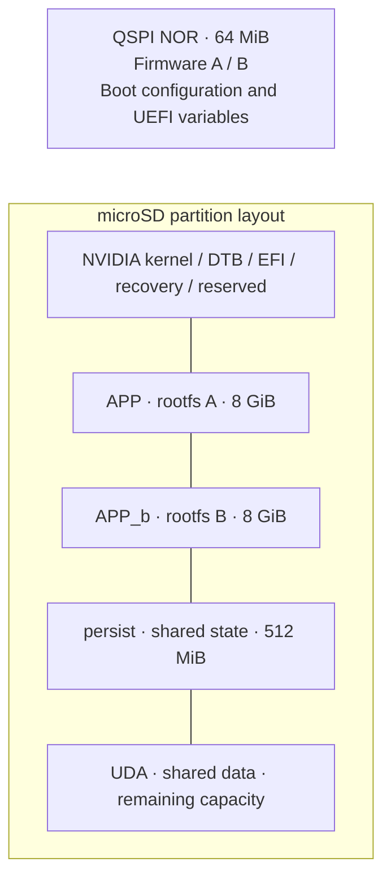

# Axiom

Embedded AI and robotics, built with Yocto.

```sh
source axiom-setup.sh -b build
bitbake axiom-image
```

Run from the workspace root after syncing `jetson-manifest`.

| Location | Contents |
|---|---|
| `conf/` | Distribution and build defaults |
| `recipes-core/images/` | `axiom-image` recipe |
| `recipes-bsp/tegra-binaries/files/` | Partition-layout XML |
| `tools/` | Setup script |
| `build/tmp/deploy/images/jetson-orin-nano-devkit/` | Generated images, relative to workspace root |



Layout defined; hardware validation, persistent mounts, overlays and SWUpdate bundles pending.
