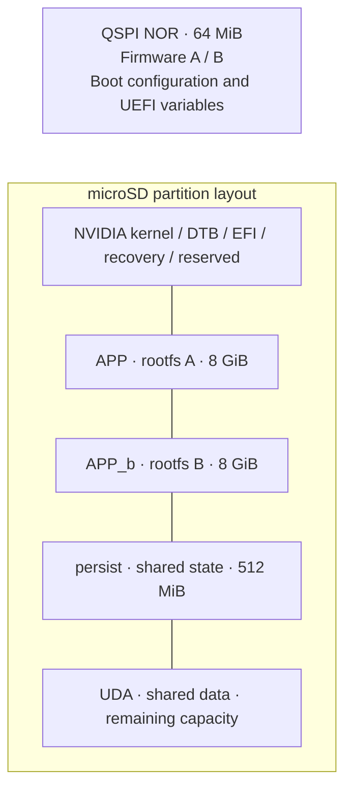

# Axiom

Embedded AI and robotics, built with Yocto.

For checkout and build instructions, see [jetson-manifest](https://github.com/Swamy-BV/jetson-manifest).

Hardware validation, persistent mounts and overlays pending.
